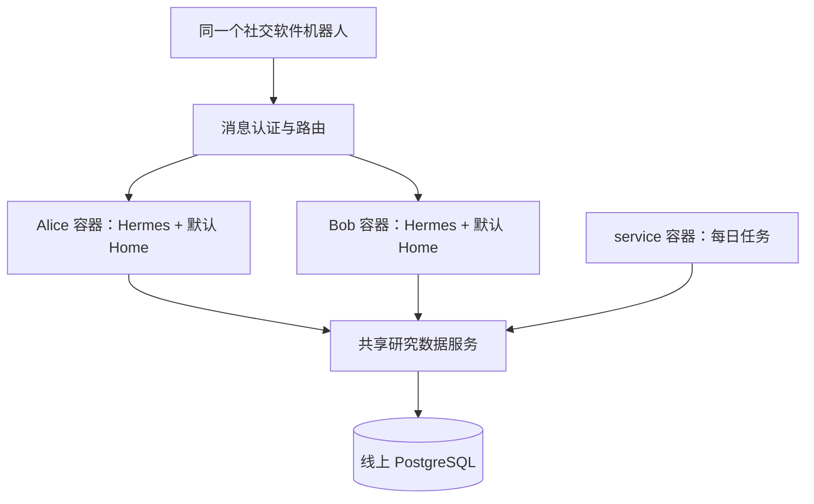
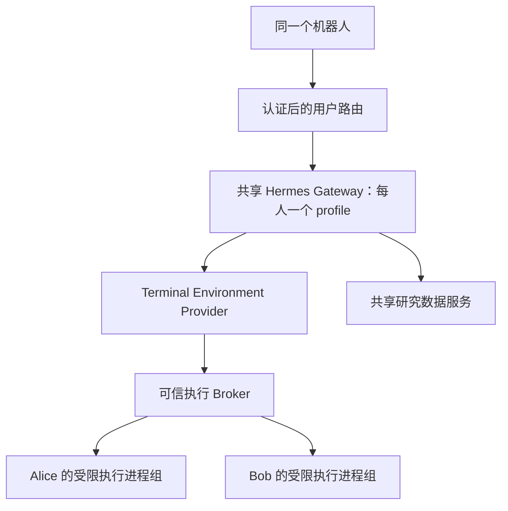

# 多用户隔离技术路线：Docker 与自定义沙箱

调研日期：2026-10-26。适用范围：约 10 位内部用户，通过社交软件私聊同一个机器人，使用 Hermes 进行研究、处理文件、修改代码及执行命令。

这是一份暂缓实施的未来多用户设计。当前 0.4.0 先完成单用户闭环，没有实现容器管理、沙箱或真实社交软件接入。文中“当前仓库”描述的是调研时的 0.3.0 基线；实际单用户变更以 README 和代码为准。

## 1. 建议与术语

**优先采用路线 A：统一消息入口 + 每用户独立的完整 Hermes 容器 + 持久化私人目录 + 共享研究数据服务。** 先让两个用户完成闭环，再根据资源实测扩展至 10 人。按需启停是后续优化，不是首个闭环的前置条件。

**路线 B 可行：共享 Hermes Gateway + 每用户 profile + 自定义 Linux 执行沙箱。** 它可能节省重复的 Hermes 进程开销，但需要完整审计文件、代码、插件和后台任务的所有执行路径，开发及维护工作更多。

两条路线的区别不是“隔离 / 不隔离”。Docker 本身就是一种沙箱实现；路线 B 指不依赖 Docker，通过成熟的 Linux 隔离组件实现自己的执行后端，而不是从零编写隔离内核。

| 名词 | 本项目中的含义 |
| --- | --- |
| 用户 | 经过平台验证并在系统登记的自然人 |
| Profile / Hermes Home | 配置、会话、记忆和 Skills 的状态目录；本身不限制文件访问 |
| 运行环境 | 一个 Hermes 进程、一个容器或一个受限制的执行进程组 |
| 执行沙箱 | 约束命令、代码及其子进程可访问的文件、进程、网络和资源 |
| 控制面 | 管理身份、成员关系、消息路由、运行环境和审计的可信服务 |

Hermes 官方明确区分 profile、工作目录和沙箱。[H1] Docker 使用 namespaces、cgroups 等内核机制建立运行边界，而不是为每个容器启动一套独立 Linux 内核。[D1]

## 2. 需求与隔离目标

1. 用户只面对一个社交软件机器人，不需要登录服务器或创建个人 Linux 账号。
2. Alice 和 Bob 的会话、记忆、上传文件、工作目录及凭据分开。
3. 用户可以使用文件、终端和代码能力；这些能力只在其授权范围内工作。
4. 同项目成员可以访问明确共享的论文、研究记录、任务和 idea。
5. 每项目只有一份论文采集任务，由 service 身份执行；当前业务时间仍是每天 10:00、Asia/Shanghai。
6. 用户只有 user / service 两种业务身份，不重新引入 reader / editor / owner 等等级。
7. 一台服务器可以承载所有环境，但不预先保证任何规格足以支撑 10 人同时研究；需测量后设定并发上限。
8. 管理员和服务器运维属于可信方。这份方案保护普通用户之间的边界，不承诺对管理员隐藏数据，也不把共享内核的隔离等同于虚拟机隔离。

验收目标包括主动尝试越权的情形：读取另一人的文件、伪造身份、猜测其他会话 ID，以及使用 Python、子进程和符号链接绕过文件工具。仅仅观察“模型没有主动读别人文件”不算验收通过。

## 3. 已有开源实现与可复用部分

| 项目 | 核实到的实现 | 本项目如何使用 |
| --- | --- | --- |
| Hermes | multiplex Gateway 和 profile_routes；同一个入口可按发送者选择 profile。[H2] | B 复用原生 profile 和路由；A 复用每实例的 API Server |
| Hermes | Docker 终端后端与完整 Hermes Docker 部署是两种机制。[H3] | A 使用完整 Agent 容器，避免混淆两种隔离范围 |
| Hermes | Terminal Environment Provider 插件接口驱动 terminal、execute_code 和文件工具。[H4] | B 在插件中接入自己的执行环境，不优先维护核心工具的私有补丁 |
| NanoClaw | 活跃会话运行在独立容器中，挂载组及会话状态，管理启动、退出与空闲回收。[N1]、[N2] | 参考精确挂载和生命周期设计；其 agent group / session 不能直接当作我们的自然人用户 |
| OpenHands SDK | DockerWorkspace、RemoteAPIWorkspace 和容器中的 Agent Server。[O1] | 参考统一入口与远程运行环境的接口；无需因此替换现有 Hermes |
| Anthropic sandbox-runtime（srt） | 使用原生系统机制限制进程树的文件与网络访问；Linux 基于 Bubblewrap。[S1] | 参考网络代理和策略组织，或作为 B 的原型候选；需锁版本 |
| Bubblewrap | 提供 namespaces 和挂载构造能力，实际安全策略由调用者定义。[S2] | B 的首选底层构件，配合资源和网络控制使用 |
| NsJail | 提供 namespaces、seccomp、rlimits 及 cgroup 集成。[S3] | B 的备选；若希望集中描述进程和资源策略，可优先评估它 |

补充判断：OpenClaw 官方将共享 Gateway 定位于一个信任边界内，也明确区分会话分离与对抗性多租户隔离。[O2] 不因为另一个框架支持多用户，就推断其所有工具都提供了文件安全边界。

## 4. 当前仓库的改造起点

下面是已阅读源码后的事实，不是计划中的新能力：

| 文件 | 当前行为 | 对新方案的影响 |
| --- | --- | --- |
| research_ideation/store/registry.py | users.profile 和 users.home 都唯一；拒绝把 default 登记为研究用户 | A 中多个容器都使用 default 和相同内部目录时，必须修改运行环境绑定模型 |
| research_ideation/runtime/hermes/adapter.py | 校验注册时与执行时的 profile / home；仅允许 CLI / local / terminal | 不能直接把社交平台消息接进来，也不能简单删除 CHANNEL_NOT_CERTIFIED 检查 |
| research_ideation/adapters/channels.py | 已有渠道身份及绑定接口；verified 参数由可信入口负责 | 需要真实的验签和身份来源，不能让模型提交 verified=true |
| research_ideation/context.py、models.py | ExecutionContext 以 profile / home 与业务用户关联 | 加入稳定 runtime_id，并保持业务身份由可信端确认 |
| research_ideation/store/local.py | 私有数据在 profile 下，项目数据在 data_root 下 | A 精确挂载；B 不向执行进程暴露其他 profile 或总数据目录 |
| research_ideation/store/shared.py | 读取共享库绑定，启动 CRA Python 子进程处理数据库请求 | 把这类共享库访问放在可信数据服务中；执行沙箱本身不覆盖所有插件代码 |
| research_ideation/runtime/hermes/profiles.py | 负责 native profile 创建、工具配置、doctor 和 cron | A 增加独立运行环境适配；B 保留 profile，但增加沙箱检查 |

Hermes 文档主分支和本机打包源码都在演进：文档列出部分多路复用的进程级共享限制，本机源码也能看到 terminal_scope、按 profile 分配环境等实现。因此既不能断言“共享 Gateway 完全没有 profile 隔离”，也不能仅凭配置名称宣称所有工具已经隔离。[H2]、[H5]

真正实施时先固定 Linux Hermes 的发布版本、镜像 digest 或源码 revision，再针对那个版本验收。本机 Windows 的安装包不能当作服务器已具备相同能力的证明。

## 5. 两条路线共同需要的能力

### 5.1 消息认证和路由

可信入口将平台消息规范化为：

```text
platform + bot_account + tenant_id + sender_id + conversation_id + message_id
```

platform / bot_account / tenant_id / sender_id 决定内部 user_id；conversation_id 决定该用户的会话；message_id 用于去重。绑定由管理员或经过验证的注册流程建立。

- 验证平台签名、令牌及平台要求的重放保护，再信任 sender_id；不使用显示昵称或模型提供的身份。
- 未绑定、已停用或撤销成员资格的用户默认拒绝；不自动掉入默认用户或 service 环境。
- 不允许普通消息修改 runtime_id、profile_routes、挂载路径、镜像和后台任务身份。
- 同用户的同一会话顺序处理；用户之间允许并发，任务总并发受全局预算控制。
- 消息重投先查询已持久化的处理状态。会话 ID 和运行 ID 都必须校验归属，不能只凭“ID 难猜”。
- 平台接入由专用模块实现；这份方案不假设个人微信、企业微信或 POPO 具有相同接口和认证方式。

### 5.2 身份与运行环境解耦

建议控制面使用以下逻辑实体；这是拟新增的数据模型，不是现有 schema：

| 实体 | 关键字段 |
| --- | --- |
| users | user_id、kind、active |
| channel_bindings | platform、bot_account、tenant_id、sender_id、user_id |
| runtime_bindings | runtime_id、user_id、backend、内部 profile 名、内部 home、状态、版本 |
| memberships | user_id、project_id、kind |
| conversations | user_id、平台会话、Hermes 会话 / 运行映射 |
| inbound_events / jobs | 去重键、状态、尝试次数、运行 ID、结果投递状态 |

profile/home 的唯一性从全局唯一调整为运行环境内约束。A 可以在不同 runtime 中重复使用 default 和 /opt/data；B 的共享进程仍为每人保留不同的 native profile。

控制面可先保留单机 SQLite，避免将运行方式调整和所有存储迁移捆成一次改造；用户业务共享知识仍使用线上 PostgreSQL。多副本入口时再迁移控制面登记库，不能在网络盘上随意共享 SQLite。

### 5.3 共享研究数据服务

建议增加一个薄的内部数据服务，把现有研究读写逻辑包装为有认证的接口：

```text
用户 Hermes / 受信工具
  → 每用户或每服务的受限访问凭据
  → 研究数据服务：查登记、成员关系和操作权限
  → 现有 Store / CRA PostgreSQL / 项目论文存储
```

这不是重写研究流程。目标是避免向每个用户环境挂载整份总注册表、CRA 管理配置和数据库管理员凭据。

- user/service 的身份、项目成员关系及 actor 由服务端根据凭据查询；不信任请求 JSON 内的 user_id、role 或 owner_id。
- 接口仅开放研究记录、检索、共享任务、论文批次和审核等明确操作，不提供任意 SQL、任意服务器路径或执行命令接口。
- 数据服务自行持有受限 PostgreSQL 应用凭据；DDL / migration 使用独立管理凭据。不给用户环境 postgres 管理连接。
- 保留 user 可以审核、service 不能审核的业务规则；停用用户后现有凭据也应被拒绝。
- 个人会话、记忆和私人文件仍在各自持久化目录。主动发布到项目的选定内容才进入共享数据路径。
- 当前项目论文 SQLite、原始资料和采集状态可以暂时保留在服务器，由数据服务访问；不把整个项目数据总目录直接挂给所有人。
- 不同时引入多人直接编辑 CRA 数据库和数据 API 两套授权真相。若确实开放直接 SQL，需单独设计每用户数据库身份和 SQL 权限。

对于未来存入同库的私人行，可增加数据库 RLS 作为第二层边界；不能用一个可绕过 RLS 的管理账号承载所有用户查询。[P1]

### 5.4 有限的公共执行接口

两条路线都由可信管理模块根据 runtime_id 选择执行器。建议内部契约包含：

```text
provision(binding)                 建立固定、经过校验的运行环境
ensure_ready(runtime_id)           启动或复用环境并等待健康检查
submit(runtime_id, conversation, message, dedup_key)
status(runtime_id, run_id)         查询状态；不得查询别人的运行
cancel(runtime_id, run_id)         取消并清理相应进程树
drain(runtime_id)                  停止接新任务，等待进行中任务结束
stop_idle(runtime_id)              仅在已确认无活动任务时停止
```

这是应用内部设计，不是 Hermes 已有命令清单。传入标识来自已验证的路由上下文，不开放给模型自由选择。用户容器或执行沙箱不能调用 provision，也不能提供任意 host_path 或启动参数。

## 6. 路线 A：每用户一个完整 Hermes Docker 容器

### 6.1 拓扑和边界



每个用户容器只有自己的 Hermes Home、workspace 和必要的临时目录。完整 Agent、插件及其子进程都在该容器的文件和进程边界内。普通用户不需要独立 Linux 登录账号；容器内部使用非 root 身份运行。

所有用户复用同一镜像；镜像固定 Hermes 和研究插件版本。该模式下每个容器的终端可以使用 local 后端，因为这个 local 指向用户容器内部，不自动要求再嵌套 Docker。

### 6.2 持久化与配置

建议服务器目录：

```text
/srv/research-data/
├── control/                       # 仅控制面可访问
├── users/
│   ├── alice/
│   │   ├── hermes/                 # 挂载到 Alice 容器 /opt/data
│   │   └── workspace/              # 挂载到 Alice 容器 /workspace
│   └── bob/
│       ├── hermes/
│       └── workspace/
├── services/research-service/      # 专用后台身份
└── projects/                      # 数据服务持有的项目原始资料
```

容器内为 Hermes Home 设置明确路径并由启动脚本校验。/opt/data 只是本方案采用的内部路径，不依赖宿主机同名目录。[H3]

配置基线：

- 非 root、no-new-privileges、移除不需要的 capabilities，使用默认 seccomp 策略；不得通过 privileged、host PID 或关闭安全策略绕过问题。[D1][D3]
- 应用与插件代码不可由普通 Agent 改写；配置中的受保护身份信息与普通可编辑记忆分开。用户要开发插件时，在个人 workspace 中开发，发布公共版本走管理员更新。
- 不挂载 /、宿主机用户主目录、其他用户目录或 Docker socket。需要共享的文件优先通过数据服务提供，确需共享挂载则明确项目和只读 / 可写模式。[D2]
- CPU、内存和进程数设上限；文件上传大小、输出、缓存和工作目录另设配额。Docker 内存限制不会自动限制磁盘占用。[D4]
- 运行管理器具有创建容器的权限，Agent 没有。首先评估 rootless；若采用 rootless，必须确认 cgroup v2、systemd 和 controller delegation 实际使限制生效，不能只看配置写了数值。[D5]、[D6]

### 6.3 消息接入方式

一个接入服务持有机器人的平台凭据，用户容器不用分别登录同一机器人。接入服务通过 Hermes 原生 API Server 与每个容器通信。[H6]

- 每个运行环境使用独立 API 凭据，API 仅在受控内部网络可达，不向聊天用户暴露管理入口。
- API 会话归属在入口登记，不转发用户自带的任意 session_id。
- 正确消费运行状态、事件和失败结果；不能把连接超时直接当成任务没执行而重复提交。
- 根据固定版本核实支持的会话续接、幂等键与取消接口，并设置自己的消息去重账本；不假设所有版本接口完全相同。
- 容器之间即使能发现对方网络地址，也不能因此调用对方 API；需要独立鉴权，并尽量配置相互访问限制。

### 6.4 用户和定时任务

每位用户一个默认 Home 足够，不强制创建 research-alice 等命名 profile；旧 profile 保留为迁移来源。

service 容器单独保存 cron 状态，不读取任何用户私人目录。首次迁移时只转移原有任务，不让新旧 scheduler 同时执行。数据库中对 project_id + 采集时间窗设置唯一批次或等效去重，避免任务重试重复入库。

### 6.5 生命周期

第一阶段使用 Compose 描述固定用户容器，由管理员启动，完成可观察的闭环。此时 Compose 只管理实例，不自动提供按用户休眠能力。

需要按需启停时增加状态机：

```text
STOPPED → STARTING → READY → RUNNING → READY → DRAINING → STOPPED
                    └────────失败────────→ FAILED
```

同用户启动要合并并发请求；等待健康检查后才投递。运行中、排队中或存在受管理后台进程时不按空闲停止。入口异常退出后根据持久化 run_id 与容器实际状态对账，不能把全部任务重新执行。

停止再启动能恢复持久化会话和文件，不等于能继续任意执行到一半的 Python 程序；长任务需要业务检查点。文件写入、共享发布和外部副作用需要幂等或明确的人工重试规则。

### 6.6 对现有代码的修改

1. 将业务用户与 native profile 解耦；控制面记录 runtime_id，内部 default 不再充当全局唯一身份。
2. adapter.py 增加经过验证的 API / 渠道入口上下文，与运行环境绑定交叉校验；保留 CLI 入口，不能简单放开所有 platform。
3. shared.py 改为调用内部数据 API；pg_worker.py 留在可信数据服务侧。项目共享本地存储也通过服务访问，私有存储保留在用户 Home。
4. 增加镜像构建、用户配置生成、Compose 部署、健康检查和运行管理。
5. 迁移用户 Home 后做路径和引用检查；原来的 permissions-sync 只能升级工具配置，不能替代该迁移。

### 6.7 优缺点

优点是隔离范围容易解释，原生工具与插件的宿主代码一起进入用户环境，依赖版本可复现，出错时可单独重建用户实例。主要成本是每个活跃用户都有自己的 Hermes 进程，以及需要运行多个实例。

容器共用镜像层能节省重复文件的磁盘空间，但不能据此声称各进程的 Python 堆内存也只占一份。没有实测前，不提供“每容器固定几百 MB”或“某规格必然够 10 人”的承诺。

## 7. 路线 B：共享 Hermes + 自定义 Linux 工具沙箱

### 7.1 选择哪一种“写沙箱”

| 做法 | 能否作为终端 / 任意 Python 的隔离边界 | 建议 |
| --- | --- | --- |
| 提示词要求只读自己的目录、设置 cwd | 不能 | 只作为使用习惯 |
| Python 函数检查路径、替换 open、命令字符串黑名单 | 不能覆盖任意进程及扩展模块 | 只用于 API 输入校验 |
| Bubblewrap / NsJail 等系统机制 + 受控执行后端 | 可以建立受内核约束的进程边界，强度取决于配置 | 作为 B 的实现基础 |

本路线的目标是共享 Hermes 主进程，将用户可控制的执行放到进程外的受限环境。不能在同一个 Python 解释器里为两个任意 Python 任务分别建立可靠的文件权限边界。

### 7.2 拓扑



Hermes 主进程负责模型循环、profile 会话和可信工具；沙箱负责命令、代码和工作文件操作。主进程仍然能访问多个用户的 profile，因此它与可信插件共同构成安全基础，不能宣称某个宿主插件被攻破后也只能看到一位用户。

### 7.3 底层选择

**首选评估 Bubblewrap + cgroup v2 + seccomp + 受控网络；如果团队更希望使用一套集中配置进程、资源限制的工具，再比较 NsJail。** 不在首版同时维护两套底层实现。[S2]、[S3]

srt 适合快速原型和参考策略，但不能将默认配置直接当作多用户隔离：它的 README 说明默认读权限较宽，写和网络采取另外的规则。必须明确隐藏其他用户和控制面，再只开放当前用户路径；它也处于研究预览阶段，需要锁定版本与回归。[S1]

Landlock 可以作为补充的内核访问控制，但本方案不把它单独当作文件、进程、网络、资源和环境管理的完整替代品。[S4]

### 7.4 每个用户环境的策略

使用最小运行根目录，包含只读的必要二进制、Python/Node 运行时和依赖；不直接只读挂载整个宿主 /，因为只读仍允许读取私人内容。工作区与缓存分用户持久化，tmp 和 /proc 使用独立视图。

| 资源 | 约束 |
| --- | --- |
| 文件 | 当前用户 workspace 可写；必要运行时及公共 Skills 只读；其他用户、控制面和管理员密钥不可见 |
| 进程 / IPC | 独立 PID / IPC namespace；不能看到宿主 /proc 或附着其他用户进程 |
| 权限 | 用户 namespace、无新权限、移除 capabilities、系统调用过滤；不依赖每用户独立 Linux 登录账号 |
| 网络 | 独立 network namespace，经受控代理访问所需外部地址；显式处理 DNS、直接 IP、IPv6 和非代理流量 |
| CPU / 内存 / PIDs | cgroup v2 管理整个进程树，超时取消时清理全部子进程；配额在执行用户代码之前生效 |
| 环境和描述符 | 环境变量白名单；关闭无关继承 FD，不把管理员数据库连接或跨用户目录句柄传入子进程 |
| 配置 | 策略、rootfs、启动参数及身份配置仅由控制面管理，用户不能修改自己的隔离策略 |

网络隔离不能只设置 HTTP_PROXY 后仍允许任意直接联网。浏览器、Git、pip 及其他工具对代理的支持需要分别检查，不能为了修一个安装失败就自动恢复宿主网络。

### 7.5 接入 Hermes 的技术路径

新增一个 backend 插件，例如 research-sandbox，由 register(ctx) 调用 ctx.register_terminal_environment_provider(...)。[H4]

1. Provider 读取可信的当前 profile / home 及路由上下文，在服务端找到 user_id / runtime_id。不能使用模型传来的 user_id 或把 task_id 直接当成授权。
2. create_environment() 从 Broker 获取当前用户的执行句柄；缓存键至少包含运行环境身份，不能只使用各 profile 都可能出现的 default 或相同会话 ID。
3. Environment 实现固定版本 BaseEnvironment 契约，包括执行、超时、清理、文件传输和真实路径处理；让 terminal、文件工具及 execute_code 使用同一个受限环境。
4. 正确实现后端路径和远程执行语义；工具生成的 Python 也必须在沙箱内运行。不能让代码执行退回主进程 Python。
5. 原生模型上下文通过 context-local scope 绑定；不在并发请求中临时修改全局 HERMES_HOME、cwd 或 os.environ 再恢复。
6. 通过 probe / doctor 真实执行隔离探针。组件缺失、namespace 创建失败或策略加载失败时拒绝执行；不退回 local。

Broker 的协议接受 user 绑定对应的环境句柄、命令、工作目录和超时等有限字段；不接受调用方自由定义宿主挂载、seccomp 参数或可见根目录。已有沙箱的复用和 namespace 进入由 Broker 实现，不把 nsenter 等控制能力交给 Agent。

终端与代码的 argv 传递避免额外 shell 拼接；当用户任务本身需要 shell 时，脚本也必须在沙箱内部解释。不能把已经接收的用户文本再拼到宿主命令中。

### 7.6 必须审计的工具边界

只注册一个 Terminal Provider 不足以覆盖所有可执行能力：

| 能力 | 放置方式 |
| --- | --- |
| 文件读取、写入、搜索、patch | 通过受限环境处理；不在宿主使用另一条快捷文件读写路径 |
| terminal / execute_code | 同用户沙箱，保持进程和 cwd 状态；确认无本地回退 |
| browser / computer_use | 使用对应用户的浏览器及执行环境；不能共用带私人登录态的宿主浏览器 |
| Skills | 宿主只提供当前 profile 的受校验内容；Skill 脚本在沙箱运行，不能自由引用其他 profile 的绝对路径 |
| 插件工具 | 可信且经过审计的研究工具可在宿主处理有限数据 API；任何运行用户脚本的工具必须进入沙箱 |
| MCP / 外部连接 | 按用户绑定配置和凭据；可执行本地服务也要受控，不能继承管理员环境 |
| delegation / 后台任务 | 继承原用户绑定，禁止自行切换成其他 profile 或 service；取消、恢复及日志也按用户分开 |
| 记忆、session_search、日志和附件 | 按当前用户和会话授权；不因没有 shell 就假设不会泄露 |

这里保持“用户能改代码和执行命令”的能力，但需要验证每项能力实际在哪执行。不能在同一宿主进程里笼统开启一切执行入口，同时承诺全部受到终端沙箱约束。

符号链接和竞态也要覆盖：宿主在处理沙箱可写目录中的附件、输出或 Skills 时，不能只做一次字符串前缀或 realpath 检查后再普通打开。应使用基于目录 FD 的受限打开 / 不跟随链接等机制，并在实际 Linux 上做竞态测试。NanoClaw 的挂载与文件交换设计可作为参考。[N1]

### 7.7 沙箱整个 Hermes 的变体

若不想审计共享主进程里的所有工具，可以让 Broker 为每位用户启动一个运行在 Bubblewrap / NsJail 中的完整 Hermes。这更接近 A 的边界，且不依赖 Docker，但仍然是多个 Hermes 进程。

它可能适合服务器不允许 Docker、但允许 user namespace 和 cgroup 委托的情况；它不会自动解决重复 Hermes 内存问题，还需要自己管理依赖 rootfs、升级和进程生命周期。

### 7.8 开发环境和限制

生产目标是 Linux。Windows 可以开发业务逻辑、协议和测试夹具，但 namespace、cgroups、seccomp、进程隔离及网络策略应在 WSL2 的 Linux 环境或实际 Linux 服务器验收，不能用普通 Windows 路径测试代替。

本次检查只发现当前 PowerShell 能找到 wsl.exe，未发现 docker / bwrap 命令；没有验证 WSL 发行版、内核能力或服务器权限，也没有执行任何 Linux 隔离测试。srt 当前 README 虽描述 Windows 后端，但不代表与 Linux 机制相同；本方案不依赖它来证明生产隔离。[S1]

## 8. 工程比较与资源判断

| 维度 | A：完整 Docker | B：共享 Hermes + 工具沙箱 |
| --- | --- | --- |
| Hermes 主进程 | 每活跃用户一个 | 共享 Gateway 主进程，仍有模型会话及执行子进程 |
| Native profile | 各容器默认 Home 足够 | 每位用户仍需独立 profile |
| 插件的宿主代码 | 也在用户容器中 | 位于共同可信主进程，需要特别审计 |
| 文件 / 命令隔离 | 由容器和精确挂载构成 | 由自定义后端与系统策略构成 |
| 依赖和升级 | 固定镜像重建，容易复现 | 维护共享依赖及最小 rootfs，或维护独立运行时 |
| 内存 | 重复 Agent 进程开销较多 | 可能减少重复主进程开销；不消除并发任务本身的开销 |
| 调试和维护 | 管理多实例，边界直观 | 代码更集中，隔离覆盖面与并发状态更难验证 |
| 当前项目适配 | 用户绑定、入口、数据 API、容器部署 | 上述公共能力 + provider、broker、策略、全工具审计 |
| 建议 | 先做可交付 MVP | 资源证据或部署限制明确后再投入 |

不能将“Docker / 不用 Docker”和“10 份 Hermes / 共享 Hermes”当作同一个问题。去掉 Docker、保留 10 个完整 Python 进程，未必显著减少内存；共享主进程但启动多个浏览器、PDF 解析或计算任务，也可能占用大量内存。

资源测量计划：

1. 同样的镜像 / 运行时、模型网关、上下文规模和工具集；关闭无关 dashboard、浏览器预启动等可选进程。
2. 测单用户空闲，再测 2、5、10 个用户空闲；运行相同的普通对话、检索、PDF 解析、代码测试和浏览器任务。
3. 记录宿主 MemAvailable、cgroup memory.current / memory.peak、CPU、PIDs、磁盘增长、首条回复和任务完成延迟。
4. 比较共享页时使用 PSS 等合适指标，避免简单累加 RSS 得到错误结论；同时观察实际宿主总内存变化。
5. 同时运行任务的容量由实测峰值和预留空间决定。初始可设保守的小并发作为运维策略，但不把它当作容量结论。
6. 若 A 的空闲成本可接受，就不开发复杂自动休眠；否则先增加受管理启停，再比较 B 是否有足够收益抵消维护成本。

## 9. 拟新增或修改的文件

以下为未来实现目录，不在本次创建这些空文件。公共层只实现一份，A / B 按选择实现。

```text
research_ideation/
├── ingress/
│   ├── identity.py          # 平台认证结果、用户与会话归属
│   ├── router.py            # 查绑定并选择运行环境，未知用户拒绝
│   └── dispatcher.py        # 去重、排队、投递状态与重试
├── runtime/
│   ├── contracts.py         # 运行标识、状态和执行器契约
│   ├── docker_runtime.py    # A：固定环境启停、健康检查和 Hermes API 客户端
│   └── hermes/
│       ├── adapter.py       # 修改：经过认证的非 CLI 上下文
│       ├── profiles.py      # 修改：区分 profile 配置与运行环境管理
│       └── sandbox_provider.py # B：Hermes provider 插件适配
├── sandbox/
│   ├── broker.py            # B：受信执行协议与环境复用
│   ├── policy.py            # B：管理员策略编译与固定路径绑定
│   └── bwrap_runtime.py     # B：进程创建、命令、取消和回收
├── service/
│   ├── api.py               # 共享研究数据的有限 HTTP 接口
│   └── auth.py              # 凭据 → 服务端用户 / 成员 / 权限
└── store/
    ├── registry.py          # 修改：user 与 runtime 解耦
    ├── control_migrations.py # 新：登记库升级，区别于现有记录库迁移
    ├── interface.py         # 修改：私有本地和共享服务组合
    ├── shared.py            # 修改：内部 API 客户端
    └── pg_worker.py         # 保留在可信数据服务侧

deploy/
├── Dockerfile               # A：固定 Hermes / 插件 / 依赖
├── compose.yaml             # A：入口、数据服务、用户和 service 实例
└── sandbox/                 # B：只读运行时、管理员策略与服务配置
```

admin.py 增加运行环境登记 / 检查及迁移入口；models.py、context.py 加入 runtime 身份；adapters/channels.py 接入平台可信认证结果。具体社交平台 adapter 在平台确定后编写，不先虚构一个可运行的微信连接器。

部署生成文件与运行数据不进入源码仓库；只提交非敏感模板。不要把每位用户的 API key、模型 key 和总数据库 URL 写入可提交的 Compose 文件。

## 10. 实施阶段和交付物

| 阶段 | 路线 A | 路线 B | 完成标准 |
| --- | --- | --- | --- |
| P0：确认环境 | 固定镜像与原生 API；确认 Engine 或平台容器权限 | 固定 Hermes / bwrap 或 NsJail；确认 userns、cgroup 和 seccomp | 隔离和资源探针可用，不需要模型 |
| P1：公共身份与数据 | 渠道绑定、运行标识、数据 API | 同左，保留每人 profile | 未注册、错误会话与越项目请求拒绝；user/service 规则保持 |
| P2：两个用户闭环 | 两个完整 Hermes 容器，默认 Home | 一个 Gateway、两个 profile、两个受限执行环境 | 可研究、改代码和测试；不能互读私有数据 |
| P3：稳定性与资源 | 2 / 5 / 10 用户实测，核对恢复与更新 | 并发 scope、工具覆盖、进程清理与相同资源实测 | 通过下述共同及路线专属验收 |
| P4：可选优化 | 按需启停、升级排空 | 更细策略及环境复用 | 只在测量表明确收益后投入 |

路线 B 在 P2 还必须交付 provider、broker、rootfs 和网络 / 资源策略；不能把“终端能跑命令”当作已经完成多用户隔离。

两条路线都先做无模型的认证、文件及进程测试，再做少量端到端模型验收。研究质量和大批量模型评测不与本次部署验收混在一起。

## 11. 验收清单

| 类别 | 必测情形 | 预期 |
| --- | --- | --- |
| 身份 | 未绑定 sender、伪造 user_id、错误 tenant、重复消息、停用用户 | 拒绝越权；同一消息不重复产生副作用 |
| 会话 | Alice 提交 Bob 的 session_id / run_id；两个用户相同外部会话编号 | 不串会话、结果、日志或运行控制 |
| 文件 | 绝对路径、../、符号链接、硬链接来源、/proc/*/root 和 FD 路径 | 不能读取 / 修改其他用户或控制面内容 |
| 任意执行 | Python open、subprocess、shell、插件脚本、后台子进程 | 同样受隔离，不能绕开专用文件工具 |
| 数据交换 | 上传附件及下载输出时替换目录为链接、路径检查期间切换链接 | 宿主不跟随到授权范围外 |
| 网络与 API | 猜测另一容器地址、访问管理接口、沙箱直接 IP / IPv6 出网 | 符合既定网络策略；无跨用户 API 权限 |
| 凭据 | 检查环境、挂载和日志；尝试提交另一用户 / service 身份 | 无其他用户和数据库管理凭据；服务端不相信身份参数 |
| 共享研究 | 同项目读取共享资料；尝试跨项目；私有内容未显式发布 | 共享正常，私有不自动进入共享结果 |
| 审核 | user 审核，service 尝试审核 | user 按业务规则允许；service 拒绝 |
| 资源 | 内存超限、进程数超限、大输出、超时、取消和后台子进程 | 范围受限，其他用户仍可用；任务状态真实 |
| 恢复 | 入口重启、执行环境崩溃、网络断开、消息重投 | 对账恢复；不盲目重做外部写操作 |
| 持久化 | 重建用户环境、更新代码、恢复备份 | 会话及私人文件保持，旧版本可回退 |
| 调度 | 单项目采集、重复触发、新旧部署切换 | 每时间窗一个逻辑批次，不重复跑两份 cron |
| B 专属 | provider 不可用、线程 scope 丢失、相同 task_id、执行器初始化失败 | 无跨用户复用；拒绝执行，不回退宿主 local |

文件安全测试使用合成的 Alice / Bob 标记及临时凭据，不读取真实私人资料证明隔离。cgroup 和网络测试只能在专用测试环境运行，避免影响共享服务器。

本次没有运行这些测试，也没有声明任一路线已通过。线上 PostgreSQL 业务表、持久化和备份仍需部署前独立检查；原有 shared-check 结果不能由一份设计文档代替。

## 12. 现有用户迁移与回退

1. 备份控制登记库、各 profile、项目 SQLite 和共享数据库；备份需要保持 SQLite 一致性，不能运行中只拷贝一个主文件忽略 WAL。
2. 建立 user → runtime 的新绑定，保留现有 user_id、project_id、任务 ID 和引用 ID。
3. A 把每位用户原 profile 的内容迁入自己的持久化 Home；B 保留原 profile 路径。密钥在服务器单独注入，不通过 Git 迁移。
4. A 为容器内部路径生成新绑定；不能直接复用 Windows 的解释器、junction 或 runtime.json 绝对路径。
5. 先迁移一个试点用户，进行私有读写、共享访问和会话恢复；再迁移其余用户。
6. 暂停旧 service 的调度，确认无进行中采集，再转移到新运行环境；业务去重仍然保留。
7. 路由切换以用户为单位进行；同一份 Hermes Home 不能同时由新旧实例写入。
8. 保留原数据和旧版本，回退前排空新环境并对账共享写入；不能仅回滚镜像而忽略已发生的数据变更。

## 13. 需要在服务器核实的条件

- 可用 CPU / 内存、磁盘容量和持久化位置；用户数与同时执行研究任务的人数分别估算。
- 是否能使用 Docker / Podman 或现有平台容器服务；如果自己已处在托管容器里，不默认假设可以再启动 Docker daemon。
- 路线 B 的非特权 user namespace、seccomp 和 cgroup 委托是否允许；Docker 不可用并不自动意味着 B 可用。
- 消息平台和正式接入方式，用户 ID 是否稳定且经平台认证，入口需要的网络可达性。
- 固定 Hermes 版本的 API、profile scope、provider 契约和全部已启用工具行为。
- PostgreSQL 应用凭据、现有业务表、备份恢复，以及允许的数据服务网络路径。

在没有这些事实前，优先完成方案和本地业务开发，不提前承诺服务器容量，也不使用 privileged 或宿主执行作为静默兼容回退。

## 14. 参考资料

所有外部资料以 2026-10-26 阅读时的内容为准。文中的目录、模块拆分、迁移步骤和阶段划分是针对本仓库提出的工程方案，不是这些项目原样提供的功能。

- [H1：Hermes Profiles](https://hermes-agent.nousresearch.com/docs/user-guide/profiles)
- [H2：Hermes 多 Gateway 与共享机器人用户路由](https://hermes-agent.nousresearch.com/docs/user-guide/multi-profile-gateways)
- [H3：Hermes Docker 部署](https://hermes-agent.nousresearch.com/docs/user-guide/docker)
- [H4：Hermes Terminal Environment Provider 插件](https://hermes-agent.nousresearch.com/docs/developer-guide/terminal-environment-plugin)
- [H5：Hermes Multiplexing Gateway 内部设计](https://hermes-agent.nousresearch.com/docs/developer-guide/multiplexing-gateway)
- [H6：Hermes API Server](https://hermes-agent.nousresearch.com/docs/user-guide/features/api-server)
- [N1：NanoClaw 安全设计](https://docs.nanoclaw.dev/concepts/security)
- [N2：NanoClaw 容器生命周期](https://docs.nanoclaw.dev/concepts/container-lifecycle)
- [O1：OpenHands SDK 架构](https://github.com/OpenHands/docs/blob/main/sdk/arch/overview.mdx)
- [O2：OpenClaw 共享 Gateway 的信任边界](https://docs.openclaw.ai/gateway/security)
- [S1：Anthropic Sandbox Runtime](https://github.com/anthropics/sandbox-runtime)
- [S2：Bubblewrap 的策略责任与使用方式](https://github.com/containers/bubblewrap)
- [S3：NsJail](https://github.com/google/nsjail)
- [S4：Linux Landlock](https://docs.kernel.org/userspace-api/landlock.html)
- [D1：Docker Engine 安全机制](https://docs.docker.com/engine/security/)
- [D2：Docker Bind Mounts](https://docs.docker.com/engine/storage/bind-mounts/)
- [D3：Docker seccomp](https://docs.docker.com/engine/security/seccomp/)
- [D4：Docker 资源限制](https://docs.docker.com/engine/containers/resource_constraints/)
- [D5：Docker Rootless](https://docs.docker.com/engine/security/rootless/)
- [D6：Rootless 的资源限制前提](https://docs.docker.com/engine/security/rootless/tips/)
- [P1：PostgreSQL 17 行级安全](https://www.postgresql.org/docs/17/ddl-rowsecurity.html)

[H1]: https://hermes-agent.nousresearch.com/docs/user-guide/profiles
[H2]: https://hermes-agent.nousresearch.com/docs/user-guide/multi-profile-gateways
[H3]: https://hermes-agent.nousresearch.com/docs/user-guide/docker
[H4]: https://hermes-agent.nousresearch.com/docs/developer-guide/terminal-environment-plugin
[H5]: https://hermes-agent.nousresearch.com/docs/developer-guide/multiplexing-gateway
[H6]: https://hermes-agent.nousresearch.com/docs/user-guide/features/api-server
[N1]: https://docs.nanoclaw.dev/concepts/security
[N2]: https://docs.nanoclaw.dev/concepts/container-lifecycle
[O1]: https://github.com/OpenHands/docs/blob/main/sdk/arch/overview.mdx
[O2]: https://docs.openclaw.ai/gateway/security
[S1]: https://github.com/anthropics/sandbox-runtime
[S2]: https://github.com/containers/bubblewrap
[S3]: https://github.com/google/nsjail
[S4]: https://docs.kernel.org/userspace-api/landlock.html
[D1]: https://docs.docker.com/engine/security/
[D2]: https://docs.docker.com/engine/storage/bind-mounts/
[D3]: https://docs.docker.com/engine/security/seccomp/
[D4]: https://docs.docker.com/engine/containers/resource_constraints/
[D5]: https://docs.docker.com/engine/security/rootless/
[D6]: https://docs.docker.com/engine/security/rootless/tips/
[P1]: https://www.postgresql.org/docs/17/ddl-rowsecurity.html
